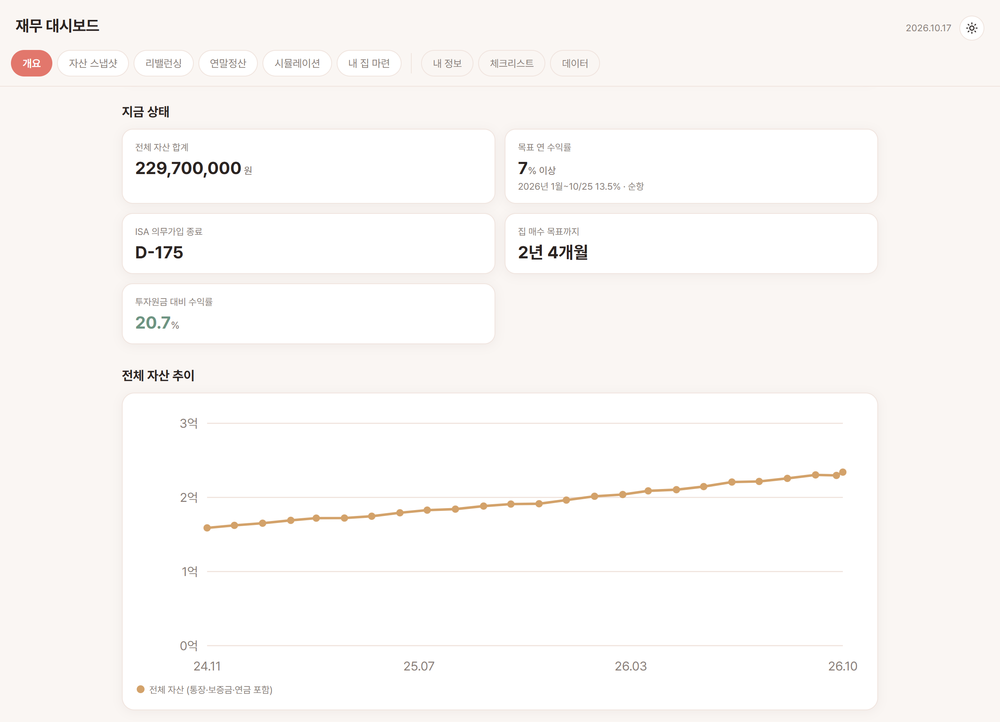
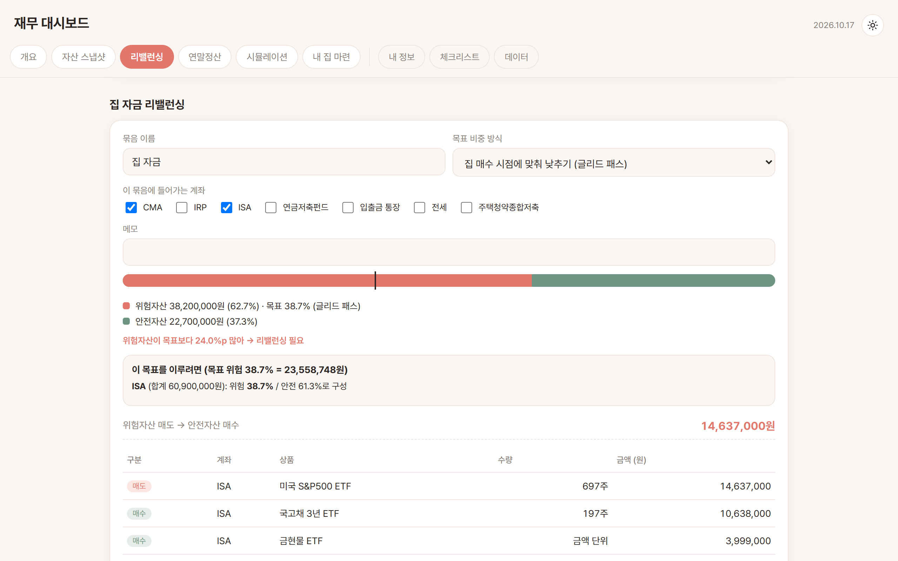
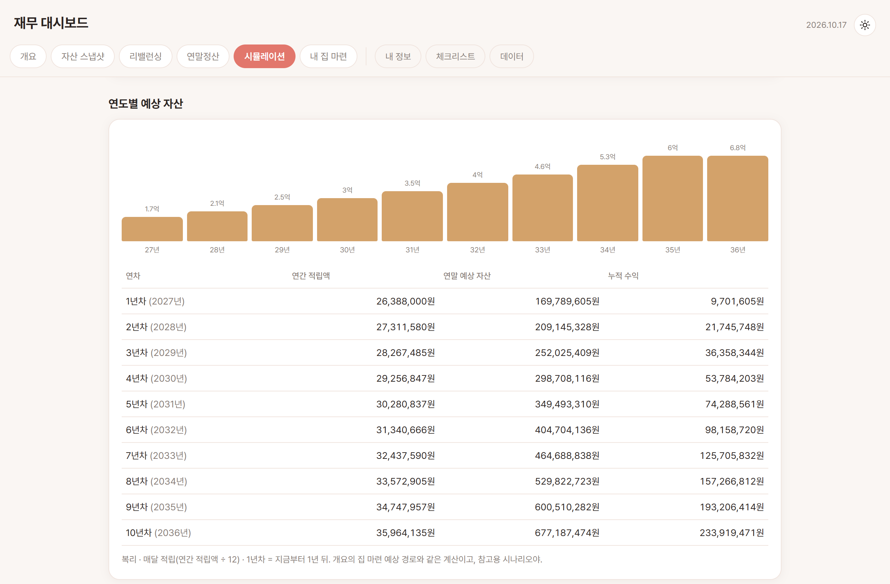
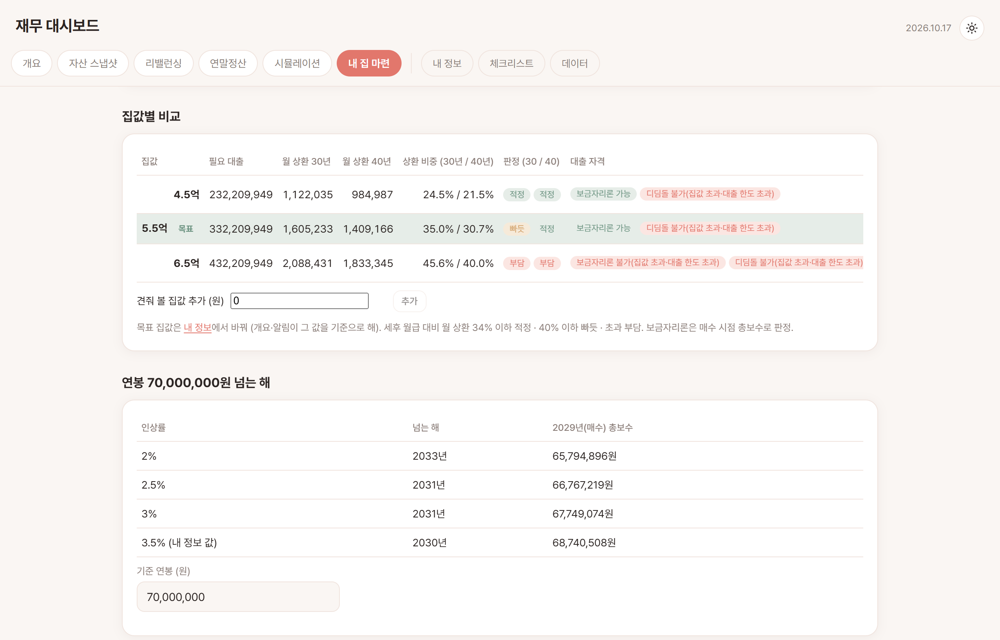

# 재무 대시보드

개인용 재무 관리 대시보드. 여러 계좌에 흩어진 자산을 한 곳에서 보고, 위험/안전 비중을 자동 계산하고, 연도별 자산 추이를 시뮬레이션하고, 내 집 마련 자금 계획을 관리합니다.

<picture>
  <source media="(prefers-color-scheme: dark)" srcset="docs/screenshots/finance-dashboard-dark.png" />
  
</picture>

<sub>개요 탭 화면 (가상 데모 데이터). GitHub 테마에 따라 라이트/다크 화면이 보입니다.</sub>

## 화면 둘러보기

| 리밸런싱 | 시뮬레이션 | 내 집 마련 |
| :-: | :-: | :-: |
| <a href="docs/screenshots/finance-dashboard-rebalance-light.png"><picture><source media="(prefers-color-scheme: dark)" srcset="docs/screenshots/finance-dashboard-rebalance-dark.png" /></picture></a> | <a href="docs/screenshots/finance-dashboard-simulation-light.png"><picture><source media="(prefers-color-scheme: dark)" srcset="docs/screenshots/finance-dashboard-simulation-dark.png" /></picture></a> | <a href="docs/screenshots/finance-dashboard-home-light.png"><picture><source media="(prefers-color-scheme: dark)" srcset="docs/screenshots/finance-dashboard-home-dark.png" /></picture></a> |
| <sub>목표 비중 맞추기, 매매 수량 계산</sub> | <sub>연도별 예상 자산</sub> | <sub>집값별 대출·상환 비교</sub> |

<sub>이미지를 누르면 원본 크기로 열립니다. 모든 캡쳐는 가상 데모 데이터로 찍었습니다.</sub>

## 구조

- `client/` — React + TypeScript (Vite), 화면
- `server/` — Express + TypeScript, API + 로컬 파일 저장
- `data/` — 실제 자산 데이터가 저장되는 곳 (`.gitignore` 처리됨, 커밋되지 않음). 환경 변수 `FD_DATA_DIR`를 지정하면 그 폴더를 대신 씁니다([여러 기기에서 같은 데이터 쓰기](#여러-기기에서-같은-데이터-쓰기-google-drive-동기화) 참고). 아래에서 `data/`라고 쓴 곳은 모두 이 데이터 폴더를 뜻합니다.

데이터는 브라우저 localStorage가 아니라 데이터 폴더의 `finance-dashboard.json` 파일에 저장되므로, 브라우저 캐시를 지워도 데이터가 유지됩니다.

서버는 이 PC(`127.0.0.1`)에서 온 요청만 받습니다. 같은 네트워크의 다른 기기나 다른 웹사이트에서는 접근할 수 없습니다.

## 실행 방법

최초 1회:

```bash
npm run install:all
```

개발 모드로 실행 (서버 + 클라이언트 동시 실행, 저장 즉시 반영):

```bash
npm run dev
```

브라우저에서 `http://localhost:5173` 접속.

평소에 계속 켜두고 쓸 때는 빌드된 버전을 서버 하나로 띄우는 게 더 간단합니다:

```bash
npm start
```

브라우저에서 `http://localhost:4300` 접속.

### 환경 변수 (모두 선택)

| 이름 | 기본값 | 용도 |
| --- | --- | --- |
| `FD_DATA_DIR` | 프로젝트의 `data/` | 데이터 폴더 위치. 클라우드 동기화 폴더로 지정해 여러 기기에서 공유 |
| `API_PORT` | `4300` | 서버 포트 (바꾸면 `client/vite.config.ts`의 프록시 주소도 함께 수정) |

환경 변수는 **서버를 켜기 전에** 설정돼 있어야 적용됩니다. 설정 전에 켜 둔 서버는 재시작하세요.

### Windows 로그인 시 자동 실행

시작프로그램에 바로가기를 등록하면 로그인할 때마다 창 없이 빌드 후 `http://localhost:4300`에 서버가 뜹니다. 로그는 프로젝트 루트의 `.finance-dashboard*.log`에 남습니다.

```powershell
powershell -ExecutionPolicy Bypass -File bin\autostart-windows.ps1            # 등록
powershell -ExecutionPolicy Bypass -File bin\autostart-windows.ps1 -Uninstall # 해제
```

지금 바로 띄우려면 `bin\start-windows.ps1`을 같은 방식으로 실행하면 됩니다.

### 여러 기기에서 같은 데이터 쓰기 (Google Drive 동기화)

데이터 폴더는 환경 변수 `FD_DATA_DIR`로 바꿀 수 있습니다. 이 값을 클라우드 동기화 폴더로 지정하면 맥북·Windows가 같은 데이터를 씁니다. 서버는 요청마다 파일을 새로 읽으므로 다시 켤 필요는 없습니다.

1. 두 기기 모두 [Google Drive for desktop](https://www.google.com/drive/download/)을 설치하고 같은 계정으로 로그인합니다.
2. **처음 한 번, 데이터가 있는 기기에서**: 서버를 끄고(`bin/finance-dashboard stop`) `data/` 폴더를 `내 드라이브/finance-dashboard-data/`로 복사합니다(명령은 아래 macOS 예시). 잘 열리는 걸 확인한 뒤 원본은 `data.bak`처럼 이름을 바꿔 둡니다.
3. 그 폴더를 두 기기 모두에서 우클릭 → **오프라인 사용 가능**으로 설정합니다. 기본 스트리밍 모드에서는 파일이 아직 안 내려온 상태일 수 있습니다.
4. 기기마다 `FD_DATA_DIR`를 지정합니다.

   macOS (zsh에서는 아직 없는 경로에 `*`를 쓰면 실패하므로, 드라이브 경로를 먼저 변수에 담습니다):

   ```bash
   GD=$(echo ~/Library/CloudStorage/GoogleDrive-*/"내 드라이브")
   cp -R data "$GD/finance-dashboard-data"   # 2번의 복사 (처음 한 번)
   echo "export FD_DATA_DIR=\"$GD/finance-dashboard-data\"" >> ~/.zshrc
   source ~/.zshrc && ls "$FD_DATA_DIR/finance-dashboard.json"
   ```

   Windows (한 번 실행 후 새 터미널, 자동 실행에도 적용됨):

   ```powershell
   [Environment]::SetEnvironmentVariable("FD_DATA_DIR", "G:\내 드라이브\finance-dashboard-data", "User")
   ```

   드라이브 언어 설정에 따라 `내 드라이브`가 `My Drive`일 수 있으니 실제 경로를 확인하세요.

주의할 점:

- **두 기기에서 동시에 쓰지 마세요.** 충돌 방지(409)는 같은 서버에 열린 탭끼리만 동작합니다. 기기를 바꾸면 먼저 페이지를 새로고침하세요.
- `bin/finance-dashboard start`와 `bin/start-windows.ps1`은 `FD_DATA_DIR`에 데이터 파일이 없으면 시작하지 않습니다(빈 기본값 파일이 생겨 동기화 충돌이 나는 것을 막기 위함). `npm run dev`에는 이 확인이 없으니 동기화가 끝난 뒤 실행하세요.
- 백업(`backups/`)과 API 키(`secrets.json`)도 같은 폴더에 있어서 함께 동기화됩니다.

## 기능

탭은 **자주 쓰는 순서**대로 앞에 있고, 가끔 여는 **보조 탭**은 구분선 뒤에 있습니다.

### 주요 탭

| 탭 | 주요 기능 |
| --- | --- |
| **개요**<br><sub>지금&nbsp;상태·할&nbsp;일</sub> | • 집 마련 '이대로면?' — 도달 시점, 늦으면 월 얼마 더 모아야 하는지, 상환 부담 판정<br>• 점검할 것 — 만기·연금/청약 한도·정책 숫자 확인 알림<br>• 이번 달 정리 — 잔액 갱신 → 연금·청약·카드 입력 → 히스토리 기록 → 리밸런싱 확인<br>• 자산 합계·추이, 위험/안전 비중, 집 마련 예상 경로 그래프<br>• 비상금(지출 몇 개월 치), ISA 의무가입 D-day, 요약 메모 |
| **자산&nbsp;스냅샷**<br><sub>계좌별&nbsp;잔액&nbsp;기록</sub> | • 잔액 입력·편집(만기일 포함), xlsx 가져오기<br>• 월간 리포트 — 자산 변화를 넣은 돈·운용 수익·그 외로 나눔, ±10% 이상 변한 계좌 경고, '요약 복사'<br>• 배당·이자 수입 기록, 상품별 예상 연 수입<br>• 투자원금 대비 수익률, 연도별 수익률과 지수·금리 비교 |
| **리밸런싱**<br><sub>목표&nbsp;비중&nbsp;맞추기</sub> | • 묶음(집 자금·노후 자금)별 목표 비중, 글리드 패스<br>• 팔고 살 상품·수량 추천, 계좌 간 이동, 새 돈만으로 맞추기<br>• 예상 수수료·세금, 시세 자동 불러오기<br>• 위험자산은 위험 상품이 있는 계좌에서만 매수 |
| **연말정산**<br><sub>줄어드는&nbsp;세금&nbsp;추정</sub> | • 연금저축·IRP, 월세, 주택청약, 카드 공제 계산, 공제 기준 숫자 설정<br>• 세금 우대 계좌 점검 — ISA 한도, 금융소득종합과세 경고, 상품별 계좌 위치 추천 |
| **시뮬레이션**<br><sub>미래&nbsp;자산&nbsp;예측</sub> | • 월 단위 복리 성장(개요의 예상 경로와 같은 계산)<br>• 수익률·저축액 민감도 표<br>• 은퇴 시뮬레이션 — 4% 룰 필요 자산, 기대수명까지 버티는지 |
| **내&nbsp;집&nbsp;마련**<br><sub>집값별&nbsp;대출&nbsp;비교</sub> | • 필요 대출·월 상환(30/40년)·상환 비중 판정<br>• 보금자리론·디딤돌 자격, 최대 적정 집값<br>• 연봉 기준 도달 연도, 목표 도달 시점 민감도 표<br>• 정책 숫자 설정(확인한 지 1년 지나면 알림), 목표 집값은 내 정보 탭에서 수정 |

### 보조 탭

| 탭 | 주요 기능 |
| --- | --- |
| **내&nbsp;정보**<br><sub>공통&nbsp;입력값</sub> | • 여러 화면이 같이 쓰는 값을 한곳에서 입력<br>• 월급·연봉 상승률, 지출 예산, 연금 계획<br>• 집 매수 예정일·목표 집값·금리 (칸마다 '쓰이는 곳' 표시) |
| **체크리스트**<br><sub>정기&nbsp;점검</sub> | • 날짜가 가까워지면 개요에 알림<br>• 연금·청약 한도 자동 표시 |
| **데이터**<br><sub>백업·복원</sub> | • 자동·수동 백업과 복원<br>• JSON 내보내기·가져오기 |

### 시세와 비교 기준

- 1주 가격 불러오기와 지수 비교(기본: S&P500·코스피200 ETF 종가)에는 **공공데이터포털 서비스 키**가 필요합니다.
- 키는 리밸런싱 탭의 '가격 불러오기'에서 등록하고, `data/secrets.json`에만 저장됩니다. 키가 없으면 금리 기준만 비교합니다.
- 비교 기준은 연도별 수익률 아래 '비교 기준 설정'에서 바꾸며, 시세는 `data/benchmark-cache.json`에 12시간 캐시됩니다.
- ETF 종가 기준이라 분배금은 빠집니다.

## 테스트

```bash
npm test
```

서버·클라이언트의 단위 테스트를 모두 실행합니다. 테스트는 임시 폴더를 쓰므로 실제 `data/`는 건드리지 않습니다.

## 데이터 백업

`data/finance-dashboard.json` 파일 하나에 모든 데이터가 들어있습니다. 저장할 때마다(10분에 한 번) `data/backups/`에 자동 백업이 쌓이고(최근 30개), 앱의 **데이터** 탭에서 복원·내보내기·가져오기를 할 수 있습니다(`data/`의 키·캐시 파일은 백업 대상이 아닙니다).
